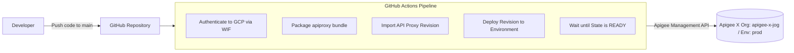
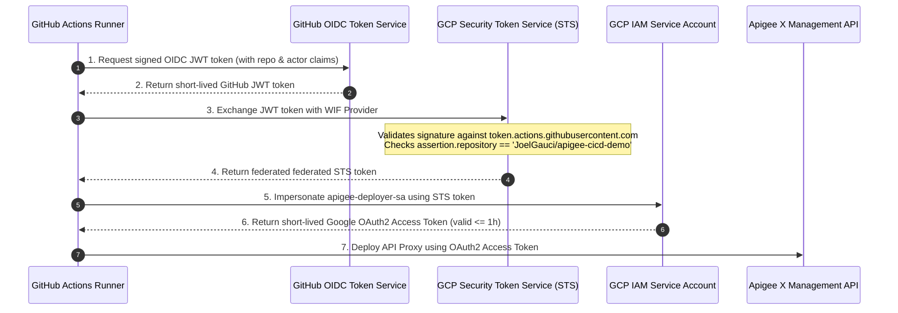

# Apigee CI/CD Demo

This project demonstrates an automated CI/CD pipeline for deploying Apigee X API proxies using GitHub Actions, integrated with Google Cloud Secret Manager, Apigee Key-Value Maps (KVM), and BDD integration testing with Apickli.

---

## Architecture & Workflow Overview



---

## Project Roadmap

| Step | Status | Description |
| :--- | :---: | :--- |
| **Step 0** | **Completed** | Project workspace initialization & documentation baseline |
| **Step 1** | **Completed** | GitHub Actions pipeline for Apigee API proxy deployment on push (using WIF) |
| **Step 2** | *Pending* | Secret Manager provisioning script & KVM synchronization (`apigee_secrets` / `secret_demo`) |
| **Step 3** | *Pending* | Apickli BDD integration test suite setup |
| **Step 4** | *Pending* | Integration of BDD tests into the CI/CD pipeline |
| **Step 5** | *Pending* | End-to-end execution, validation, and final wrap-up |

---

## Project Structure

```text
apigee-cicd-demo/
├── .github/
│   └── workflows/
│       └── deploy.yml      # CI/CD deployment pipeline for Apigee X (Workload Identity Federation)
├── apiproxy/               # Apigee API Proxy source code (apigee-cicd-v1)
│   ├── apigee-cicd-v1.xml
│   ├── policies/
│   │   └── KVM-GetSecret.xml
│   ├── proxies/
│   │   └── default.xml
│   └── targets/
│       └── default.xml
├── scripts/                # Utility scripts (Secret Manager setup, etc.)
├── tests/                  # Apickli BDD test suite
└── README.md               # Project documentation
```

---

## Workload Identity Federation (WIF) & Security Hardening

In traditional CI/CD setups, integrating GitHub Actions with Google Cloud relies on **downloadable Service Account JSON keys** stored as static repository secrets (`GCP_SA_KEY`). 

However, static service account keys introduce major security liabilities:
- **Credential leakage risks**: Keys stored long-term in GitHub Secrets, CI logs, or developer machines can be compromised or exfiltrated.
- **No automatic rotation**: Keys rarely get rotated regularly, increasing exposure time.
- **Enterprise restrictions**: Enterprise GCP organizations routinely enforce the constraint `constraints/iam.disableServiceAccountKeyCreation`, which strictly blocks the creation of service account keys.

### How Workload Identity Federation Works

Workload Identity Federation eliminates service account keys entirely by establishing a federated trust relationship between **GitHub Actions (OIDC Provider)** and **Google Cloud IAM (Security Token Service - STS)**.



### Security Benefits of WIF

1. **Keyless Authentication (Zero Secrets)**
   - No sensitive JSON credentials are created, downloaded, or persisted in GitHub repository secrets or local filesystems.
   - Eliminates secret management overhead, rotation lifecycles, and risk of accidental git commits.

2. **Strict Attribute Mapping & Scoping**
   - The Workload Identity Provider enforces attribute conditions:
     ```text
     assertion.repository == 'JoelGauci/apigee-cicd-demo'
     ```
   - Only jobs executed within this exact GitHub repository can exchange tokens. Forks, unauthorized branches, or external repositories cannot impersonate the service account.

3. **Short-Lived Ephemeral Tokens**
   - Tokens issued by GCP STS are temporary access tokens valid only for the duration of the deployment step (typically 1 hour or less).
   - In the event of a runner memory capture, the token quickly expires, severely limiting the blast radius.

4. **Enhanced Auditability & Compliance**
   - Every deployment request recorded in Google Cloud Audit Logs contains metadata from the GitHub OIDC assertion (e.g. `workflow`, `actor`, `ref`, and `repository`).
   - Fully satisfies CIS Google Cloud Platform Benchmarks and enterprise Zero Trust security policies (`constraints/iam.disableServiceAccountKeyCreation`).

---

## Setup & GitHub Integration Guide (Step 1)

### 1. Workload Identity Federation (WIF) Configuration Details

- **GCP Project**: `apigee-x-jog` (Project Number: `1014194238001`)
- **Service Account**: `apigee-deployer-sa@apigee-x-jog.iam.gserviceaccount.com`
- **WIF Pool**: `github-pool`
- **WIF Provider**: `projects/1014194238001/locations/global/workloadIdentityPools/github-pool/providers/github-provider`

Required IAM roles configured on `apigee-deployer-sa`:
- `roles/apigee.admin` (Apigee management and deployment privileges)
- `roles/iam.workloadIdentityUser` bound to `principalSet://.../attribute.repository/JoelGauci/apigee-cicd-demo`

### 2. Workflow Trigger & Push

The workflow is located in [`.github/workflows/deploy.yml`](file://.github/workflows/deploy.yml).

To push and run the pipeline:
```bash
git add .github/ .gitignore README.md
git commit -m "docs: document Workload Identity Federation and security hardening"
git push origin main
```

The pipeline will automatically authenticate keylessly via WIF, package the `apiproxy` bundle, import the revision into Apigee X, and deploy it to the `prod` environment.
