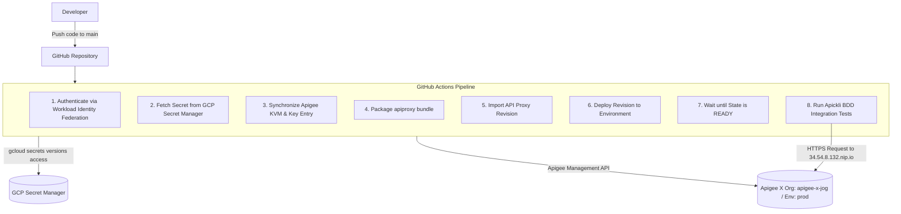
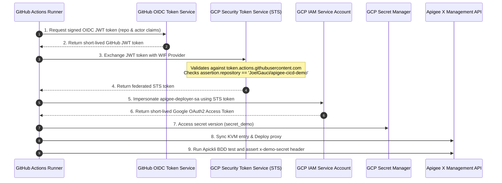

# Apigee CI/CD Demo

This project demonstrates an automated CI/CD pipeline for deploying Apigee X API proxies using GitHub Actions, integrated with Google Cloud Secret Manager, Apigee Key-Value Maps (KVM), and BDD integration testing with Apickli.

---

## Architecture & Workflow Overview



---

## Project Roadmap

| Step | Status | Description |
| :--- | :---: | :--- |
| **Step 0** | **Completed** | Project workspace initialization & documentation baseline |
| **Step 1** | **Completed** | GitHub Actions pipeline for Apigee API proxy deployment on push (using WIF) |
| **Step 2** | **Completed** | Secret Manager provisioning script & KVM synchronization (`apigee_secrets` / `secret_demo`) |
| **Step 3** | **Completed** | Apickli BDD integration test suite setup |
| **Step 4** | **Completed** | Integration of BDD tests into the CI/CD pipeline |
| **Step 5** | *Pending* | End-to-end execution, validation, and final wrap-up |

---

## Project Structure

```text
apigee-cicd-demo/
├── .github/
│   └── workflows/
│       └── deploy.yml              # CI/CD deployment pipeline with Secret Manager, KVM sync & BDD tests
├── apiproxy/                       # Apigee API Proxy source code (apigee-cicd-v1)
│   ├── apigee-cicd-v1.xml
│   ├── policies/
│   │   └── KVM-GetSecret.xml
│   ├── proxies/
│   │   └── default.xml
│   └── targets/
│       └── default.xml
├── scripts/
│   ├── cleanup.sh                  # Cleanup script to delete Apigee proxy, KVM, and Secret
│   └── create_secret.sh            # Shell script to create GCP secret and grant CI/CD access
├── test/                           # Apickli BDD test suite
│   ├── integration/
│   │   └── features/
│   │       ├── apigee-cicd.feature # BDD feature file testing x-demo-secret
│   │       ├── step_definitions/
│   │       │   └── steps.js        # Step definitions asserting response code and secret header
│   │       └── support/
│   │           └── init.js         # Apickli initialization (APIGEE_HOSTNAME & DEMO_SECRET)
│   └── package.json                # Test dependencies (@cucumber/cucumber, apickli)
├── package.json                    # Root package.json
└── README.md                       # Project documentation
```

---

## Workload Identity Federation (WIF) & Security Hardening

In traditional CI/CD setups, integrating GitHub Actions with Google Cloud relies on **downloadable Service Account JSON keys** stored as static repository secrets (`GCP_SA_KEY`). 

However, static service account keys introduce major security liabilities:
- **Credential leakage risks**: Keys stored long-term in GitHub Secrets, CI logs, or developer machines can be compromised or exfiltrated.
- **No automatic rotation**: Keys rarely get rotated regularly, increasing exposure time.
- **Enterprise restrictions**: Enterprise GCP organizations routinely enforce the constraint `constraints/iam.disableServiceAccountKeyCreation`, which strictly blocks the creation of service account keys.

### How Workload Identity Federation Works

Workload Identity Federation eliminates service account keys entirely by establishing a federated trust relationship between **GitHub Actions (OIDC Provider)** and **Google Cloud IAM (Security Token Service - STS)**.



### Security Benefits of WIF

1. **Keyless Authentication (Zero Secrets)**: No static credentials stored in GitHub Secrets or disk.
2. **Strict Attribute Mapping & Scoping**: Only repository `JoelGauci/apigee-cicd-demo` can authenticate.
3. **Short-Lived Ephemeral Tokens**: Temporary tokens valid $\le$ 1 hour minimize the attack surface.
4. **Enhanced Auditability & Compliance**: Full traceability in Google Cloud Audit Logs.

---

## Step 2: Secret Manager & KVM Synchronization

### 1. Provision Secret in GCP Secret Manager

Run the helper script [`scripts/create_secret.sh`](file:///usr/local/google/home/joelgauci/repo/apigee-cicd-demo/scripts/create_secret.sh) from your local terminal:

```bash
# Basic usage (uses default secret name 'secret_demo')
./scripts/create_secret.sh

# Or specify custom secret name and value:
./scripts/create_secret.sh "secret_demo" "MySecuredSecretDemo2026!"
```

The script performs the following actions:
1. Enables the `secretmanager.googleapis.com` API if not yet enabled.
2. Creates the secret `secret_demo` with automatic replication.
3. Adds a new version containing the secret value.
4. Grants `roles/secretmanager.secretAccessor` on the secret to the Service Account `apigee-deployer-sa@apigee-x-jog.iam.gserviceaccount.com`.

### 2. CI/CD Pipeline KVM Synchronization

During each CI/CD execution:
1. **Secret Retrieval**: The pipeline fetches the latest version of `secret_demo` from Secret Manager using `gcloud secrets versions access`.
2. **Log Masking**: The value is registered with `::add-mask::` so that it will never appear in GitHub Actions console logs.
3. **KVM Creation**: The pipeline queries `GET /v1/organizations/apigee-x-jog/environments/prod/keyvaluemaps/apigee_secrets`. If it does not exist (HTTP 404), it creates the encrypted KVM.
4. **Key Entry Upsert**: The pipeline queries `GET .../keyvaluemaps/apigee_secrets/entries/secret_demo`. If present, it sends a `PUT` request to update the value; if absent, it sends a `POST` request to create the entry.
5. **Proxy Execution**: At runtime, the policy [`KVM-GetSecret.xml`](file:///usr/local/google/home/joelgauci/repo/apigee-cicd-demo/apiproxy/policies/KVM-GetSecret.xml) retrieves the value from `apigee_secrets` under key `secret_demo`.

---

## Steps 3 & 4: Apickli BDD Integration Testing

The BDD integration test suite uses [Apickli](https://github.com/apickli/apickli) and [Cucumber.js](https://cucumber.io/) following the structure recommended by `apigee/devrel`.

### 1. Feature Specification ([`test/integration/features/apigee-cicd.feature`](file:///usr/local/google/home/joelgauci/repo/apigee-cicd-demo/test/integration/features/apigee-cicd.feature))

```gherkin
Feature: Apigee CI/CD Demo - API Proxy Integration Tests

  Scenario: Verify API proxy deployment and KVM secret injection
    When I GET /mock/v1/echo
    Then response code should be 200
    And response body should be valid json
    And response header x-demo-secret should exist
    And response header x-demo-secret should be `DEMO_SECRET`
```

### 2. Assertion Logic ([`test/integration/features/step_definitions/steps.js`](file:///usr/local/google/home/joelgauci/repo/apigee-cicd-demo/test/integration/features/step_definitions/steps.js))

The test step `response header x-demo-secret should be `DEMO_SECRET`` verifies:
- That `x-demo-secret` is present (either in the HTTP response headers or echoed by `/echo` in `headers.x-demo-secret`).
- That its value matches the exact secret retrieved from GCP Secret Manager during pipeline execution.

### 3. Running Tests Locally

```bash
cd test
npm install
export APIGEE_HOSTNAME="34.54.8.132.nip.io"
export DEMO_SECRET="MySecuredSecretDemo2026!"
npm test
```

---

## Environment Cleanup

To delete all resources provisioned during this demo, run the cleanup script:

```bash
./scripts/cleanup.sh
```

This script will:
1. Undeploy any deployed revisions of `apigee-cicd-v1` from environment `prod`.
2. Delete the API Proxy `apigee-cicd-v1` from organization `apigee-x-jog`.
3. Delete the KVM `apigee_secrets` from environment `prod`.
4. Delete the secret `secret_demo` from Google Cloud Secret Manager.
