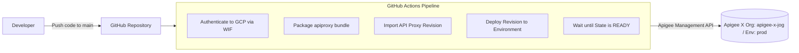

# Apigee CI/CD Demo

This project demonstrates an automated CI/CD pipeline for deploying Apigee X API proxies using GitHub Actions, integrated with Google Cloud Secret Manager, Apigee Key-Value Maps (KVM), and BDD integration testing with Apickli.

---

## Architecture & Workflow Overview



---

## Project Roadmap

| Step | Status | Description |
| :--- | :---: | :--- |
| **Step 0** | **Completed** | Project workspace initialization & documentation baseline |
| **Step 1** | **Completed** | GitHub Actions pipeline for Apigee API proxy deployment on push (using WIF) |
| **Step 2** | *Pending* | Secret Manager provisioning script & KVM synchronization (`apigee_secrets` / `secret_demo`) |
| **Step 3** | *Pending* | Apickli BDD integration test suite setup |
| **Step 4** | *Pending* | Integration of BDD tests into the CI/CD pipeline |
| **Step 5** | *Pending* | End-to-end execution, validation, and final wrap-up |

---

## Project Structure

```text
apigee-cicd-demo/
├── .github/
│   └── workflows/
│       └── deploy.yml      # CI/CD deployment pipeline for Apigee X (Workload Identity Federation)
├── apiproxy/               # Apigee API Proxy source code (apigee-cicd-v1)
│   ├── apigee-cicd-v1.xml
│   ├── policies/
│   │   └── KVM-GetSecret.xml
│   ├── proxies/
│   │   └── default.xml
│   └── targets/
│       └── default.xml
├── scripts/                # Utility scripts (Secret Manager setup, etc.)
├── tests/                  # Apickli BDD test suite
└── README.md               # Project documentation
```

---

## Setup & GitHub Integration Guide (Step 1)

### 1. Workload Identity Federation (WIF) Configuration

Authentication is completely keyless using Workload Identity Federation:

- **GCP Project**: `apigee-x-jog` (Project Number: `1014194238001`)
- **Service Account**: `apigee-deployer-sa@apigee-x-jog.iam.gserviceaccount.com`
- **WIF Provider**: `projects/1014194238001/locations/global/workloadIdentityPools/github-pool/providers/github-provider`

Required IAM roles on `apigee-deployer-sa`:
- `roles/apigee.admin`
- `roles/iam.workloadIdentityUser` bound to GitHub repo `JoelGauci/apigee-cicd-demo`

### 2. Commit and Push to Trigger the Pipeline

No GitHub Secrets need to be created. Commit and push the workflow to GitHub:
```bash
git add .github/ .gitignore README.md
git commit -m "feat: configure Apigee deployment pipeline with Workload Identity Federation"
git push origin main
```

The workflow will automatically trigger on push to `main` when `apiproxy/**` or workflow files change. You can also trigger it manually from the **Actions** tab in GitHub (**Run workflow**).
