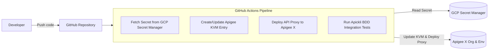

# Apigee CI/CD Demo

This project demonstrates an automated CI/CD pipeline for deploying Apigee X API proxies using GitHub Actions, integrated with Google Cloud Secret Manager, Apigee Key-Value Maps (KVM), and BDD integration testing with Apickli.

---

## Architecture & Workflow Overview



---

## Project Roadmap

| Step | Status | Description |
| :--- | :---: | :--- |
| **Step 0** | **Completed** | Project workspace initialization & documentation baseline |
| **Step 1** | *Pending* | GitHub Actions pipeline for Apigee API proxy deployment on push |
| **Step 2** | *Pending* | Secret Manager provisioning script & KVM synchronization (`apigee_secrets` / `secret_demo`) |
| **Step 3** | *Pending* | Apickli BDD integration test suite setup |
| **Step 4** | *Pending* | Integration of BDD tests into the CI/CD pipeline |
| **Step 5** | *Pending* | End-to-end execution, validation, and final wrap-up |

---

## Project Structure

```text
apigee-cicd-demo/
├── .github/
│   └── workflows/          # GitHub Actions workflow definitions (Step 1 & Step 2)
├── apiproxy/               # Apigee API Proxy bundle source code (Step 0 - to be placed)
├── scripts/                # Helper scripts (e.g. Secret Manager creation script)
├── tests/                  # Apickli BDD test definitions, features, and step definitions
└── README.md               # Project documentation and guide
```

---

## Prerequisites

- Google Cloud Project with Apigee X enabled.
- Service Account with permissions for:
  - Apigee deployment (`roles/apigee.admin` or custom scoped role)
  - Secret Manager access (`roles/secretmanager.secretAccessor`)
- Workload Identity Federation (WIF) or GCP Service Account Key configured as a GitHub Secret.
- Node.js & npm (for Apickli BDD testing).
